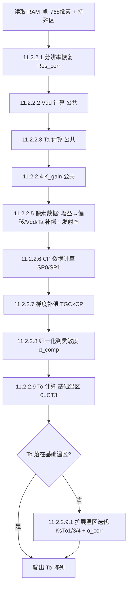

# MLX90640 温度计算数学 — 完整笔记（Datasheet Rev 11 §11 转写）

> **来源**: MLX90640 32x24 IR array Datasheet, REVISION 11 – 4 MAY 2018, §11 "Calculating Object
> Temperature"（PDF p21–p45，含 Table 10/11/12、Figure 15/16/17）。
> **转写方法**: 文本层（pdftotext）+ 页面图像视觉转写（pdftoppm 130dpi → 视觉模型逐页转写），
> 全部位段/定标/符号分支均以 Table 12（自带解码值的示例标定数据）做算术交叉验证。
> **用途**: `src/ee.rs`（M2 补偿算法）的唯一权威依据；Rust 实现与本笔记逐条对应。
> **状态**: 公式链已完整；示例算例有少量 datasheet 自身笔误，见 [§5 勘误](#5-勘误与不一致)。

---

## 目录

1. [内存映射（寄存器 / RAM / EEPROM）](#1-内存映射)
2. [§11.1 EEPROM 标定数据恢复链](#2-eeprom-标定数据恢复链-111--11117)
3. [§11.2 逐帧温度计算流](#3-逐帧温度计算流-1122)
4. [黄金测试向量（Table 11/12 算例）](#4-黄金测试向量-table-1112-算例)
5. [勘误与不一致](#5-勘误与不一致)
6. [实现映射与真机验证](#6-实现映射与真机验证)

---

## 1. 内存映射

MLX90640 有三个地址窗口（16 位字寻址，SMBus Read Word/Block）：

```
┌────────────────────────────────────────────────────────────────────┐
│ 0x0000–0x03FF   RAM 保留                                              │
│ 0x0400–0x06FF   RAM 像素区（768 字 = 32×24，两个子页交织存放）          │
│ 0x0700–0x073F   RAM 特殊数据区（Figure 15/16，见下）                   │
│ 0x2400–0x243F   EEPROM 全局标定参数（64 字）                           │
│ 0x2440–0x273F   EEPROM 逐像素标定（768 字，一像素一字）                 │
│ 0x8000–0x80FF   配置寄存器窗口（Status=0x8000, Ctrl1=0x800D,          │
│                  I2C 配置=0x800F）                                    │
└────────────────────────────────────────────────────────────────────┘
```

### RAM 特殊数据区（Figure 15/16，Chess 与 Interleaved 布局相同）

```
地址        内容                         算例值(Table 11)    说明
─────────────────────────────────────────────────────────────────────
0x0700      Ta_Vbe  (Vbe)                0x4BF2 (19442)    带隙电压计数
0x0708      CP (SP0) 补偿像素子页0         0xFFCA (-54)      小负数属正常!
0x070A      GAIN (RAM 增益)               0x1881 (6273)
0x0720      Ta_PTAT (PTAT)               0x06AF (1711)     正数(数百~数千)
0x0728      CP (SP1) 补偿像素子页1         0xFFC8 (-56)      小负数属正常!
0x072A      VDDpix (Vdd 读数)             0xCCC5 (-13115)
其余        Melexis 保留
─────────────────────────────────────────────────────────────────────
```

> ⚠️ **血泪教训**（本项目实测）：把 0x0708 误当 PTAT 读会得到恒定小负数（−49 上下），
> 看起来像"模拟前端欠压"，其实 0x0708 是 CP(SP0)——**天生就是小负数**。真 PTAT 在
> 0x0720，正常读数为正的数百到数千。本项目曾据此误诊"需 5V 供电"，实测 3.3V 下
> PTAT=+1599、Vbe=+18942，模拟前端完全健康（详见 [§6](#6-实现映射与真机验证)）。

### 配置寄存器（0x8000 窗口）

- `0x8000` Status：bit0 = 新数据可用（子页序号在 bit3/bit4 等，帧同步用）
- `0x800D` Control register 1：bits[11:10] = ADC 分辨率档（`Resolution_REG`，默认 2 = 18bit）
- `0x800F` I2C 配置（FM+、阈值电平等，一般不动）

---

## 2. EEPROM 标定数据恢复链（§11.1.1 – 11.1.17）

**通则**：EEPROM 一律按 **two's complement（补码）** 解读，除非特别注明 unsigned。
下文 `EE[A]` 表示 EEPROM 字地址 A 的 16 位内容；`signedN(v)` 表示 N 位补码转换
（`if v > 2^(N-1)-1 { v -= 2^N }`）。

### 全局参数字位图（一图流）

```
0x2410  ┌ α_PTAT(4) ┬ scale_OCC_row(4) ┬ scale_OCC_col(4) ┬ scale_OCC_rem(4) ┐
        └  [15:12]  ┘    [11:8]        ┘     [7:4]        ┘      [3:0]       ┘

0x2411  Offset_average (16, signed)

0x2412–0x2417  OCC_rows:    每字 4×4bit，行号 = (字-0x2412)*4 + nibble序(从LSB)
0x2418–0x241F  OCC_columns: 每字 4×4bit，列号 = (字-0x2418)*4 + nibble序(从LSB)
                （nibble = signed4: >7 则 -16）

0x2420  ┌ α_scale(4) ┬ scale_ACC_row(4) ┬ scale_ACC_col(4) ┬ scale_ACC_rem(4) ┐
        └  [15:12]   ┘     [11:8]       ┘      [7:4]       ┘       [3:0]      ┘

0x2421  α_reference (Pix_sensitivity_average, 16, signed)

0x2422–0x2427  ACC_rows:    每字 4×4bit（nibble signed4）
0x2428–0x242F  ACC_columns: 每字 4×4bit

0x2430  GAIN (16, signed)
0x2431  V_PTAT25 (16, signed)

0x2432  ┌ K_VPTAT(6) ┐┌────────── K_TPTAT(10) ──────────┐
        └  [15:10]   ┘┘            [9:0]                ┘   （两段独立补码）

0x2433  ┌ K_Vdd(8) ┐┌ Vdd_25(8) ┐
        └ [15:8]   ┘┘   [7:0]   ┘

0x2434  ┌ Kv RO×CO(4) ┬ Kv RE×CO(4) ┬ Kv RO×CE(4) ┬ Kv RE×CE(4) ┐
        （R=行 C=列；O=奇数 E=偶数；nibble signed4, >7→-16）

0x2435  ┌ IL_CHESS_C3(5) ┬ IL_CHESS_C2(5) ┬ IL_CHESS_C1(6) ┐
        └     [15:11]    ┘     [10:6]     ┘     [5:0]      ┘   （各自补码）

0x2436  ┌ Kta_RO×CO(8) ┐┌ Kta_RE×CO(8) ┐
0x2437  ┌ Kta_RO×CE(8) ┐┌ Kta_RE×CE(8) ┐   （byte signed8, >127→-256）

0x2438  ┌ MLX保留(2) ┬ Resolution_cal(2) ┬ Kv_scale(4) ┬ Kta_scale_1(4) ┬ Kta_scale_2(4) ┐
        └  [15:14]   ┘     [13:12]       ┘   [11:8]    ┘     [7:4]      ┘     [3:0]      ┘

0x2439  ┌ CP_P1/P0_ratio(6) ┐┌────── α_CP_SP0(10) ──────┐
        └      [15:10]      ┘┘          [9:0]           ┘

0x243A  ┌ Off_CP_SP1_delta(6) ┐┌──── Off_CP_SP0(10) ────┐

0x243B  ┌ K_VCP(8) ┐┌ K_TaCP(8) ┐

0x243C  ┌ KsTa(8) ┐┌ TGC(8) ┐

0x243D  ┌ KsTo2(8) ┐┌ KsTo1(8) ┐     （byte signed8）
0x243E  ┌ KsTo4(8) ┐┌ KsTo3(8) ┐

0x243F  ┌ MLX保留(2) ┬ Step(2) ┬ CT4(4) ┬ CT3(4) ┬ KsTo_scale(4) ┐
        └  [15:14]   ┘ [13:12] ┘ [11:8] ┘ [7:4]  ┘     [3:0]      ┘
```

### 逐像素标定字位图（0x2440 + (row−1)*32 + (col−1)，row∈[1,24], col∈[1,32]）

```
        ┌ offset(6) ┐┌ α_pixel(6) ┐┌ Kt4(3) ┐┌ Outlier(1) ┐
        └  [15:10]  ┘┘    [9:4]   ┘┘  [3:1]  ┘┘    [0]     ┘
          signed6      signed6       signed3     1=超差像素
          (>31→-64)    (>31→-64)    (>3→-8)
```

验证：像素 (12,16) → (12−1)*32+(16−1) = 367 = 0x16F → EE 地址 **0x25AF**（与 RAM
像素数据 RAM[0x056F] 的线性序号一致：0x0400+367=0x056F ✓）。

> **NOTE 1**（datasheet）：0x2440–0x273F 中任一像素字为 0x0000 表示该像素失效，Ta/To
> 计算不应信任该像素；可用邻域均值或 −273.15°C 填充。
> **NOTE 2**：像素字 bit0=1 表示该像素至少一项标定超差（Outlier），精度不保证，可用邻域均值替代。
> **NOTE 3**：最多允许 4 个偏差像素。

### 11.1.1 VDD 传感器参数

```
K_Vdd   = signed8( (EE[0x2433] & 0xFF00) >> 8 ) × 2^5
Vdd_25  = ( (EE[0x2433] & 0x00FF) - 256 ) × 2^5 - 2^13
```

### 11.1.2 Ta 传感器参数（PTAT 族）

```
K_VPTAT = signed6( (EE[0x2432] & 0xFC00) >> 10 ) / 2^12
K_TPTAT = signed10( EE[0x2432] & 0x03FF ) / 2^3
V_PTAT25 = signed16( EE[0x2431] )
α_PTAT_EE = (EE[0x2410] & 0xF000) >> 12          （unsigned）
α_PTAT   = α_PTAT_EE / 2^2 + 8
```

### 11.1.3 偏移恢复（offset）

```
pix_OS_ref(i,j) = Offset_average
                + OCC_row_i    × 2^scale_OCC_row
                + OCC_column_j × 2^scale_OCC_col
                + offset(i,j)  × 2^scale_OCC_remnant

Offset_average = signed16(EE[0x2411])
OCC_row_i     = signed4( (EE[0x2412 + (i-1)/4] >> (4*((i-1)%4))) & 0xF )   # 行nibble
OCC_col_j     = signed4( (EE[0x2418 + (j-1)/4] >> (4*((j-1)%4))) & 0xF )   # 列nibble
scale_OCC_row = (EE[0x2410] & 0x0F00) >> 8      （unsigned）
scale_OCC_col = (EE[0x2410] & 0x00F0) >> 4      （unsigned）
scale_OCC_rem =  EE[0x2410] & 0x000F            （unsigned）
offset(i,j)   = signed6( (EE[pix_word(i,j)] & 0xFC00) >> 10 )
```

#### 11.1.3.1 Interleaved 模式的偏移修正（选读，出厂 Chess 模式不需要）

```
IL_CHESS_C1_EE = signed6( EE[0x2435] & 0x003F )          →  C1 = C1_EE / 2^4
IL_CHESS_C2_EE = signed5( (EE[0x2435] & 0x07C0) >> 6 )   →  C2 = C2_EE / 2^1
IL_CHESS_C3_EE = signed5( (EE[0x2435] & 0xF800) >> 11 )  →  C3 = C3_EE / 2^3

IL_PATTERN(pixel_number) = int((pn-1)/32) - int(int((pn-1)/32)/2)*2
Conversion_pattern(pn)   = ( int((pn-3)/4) - int((pn-2)/4)
                          + int(pn/4)     - int((pn-1)/4) ) × (1 - 2×IL_PATTERN)

pix_OS(i,j) = pix_OS_ref(i,j)
            + IL_CHESS_C1 × (2×IL_PATTERN - 1)
            - IL_CHESS_C2 × Conversion_pattern        # chess→IL 修正项
```

### 11.1.4 灵敏度恢复（α）

```
α(i,j) = ( α_reference
         + ACC_row_i    × 2^scale_ACC_row
         + ACC_column_j × 2^scale_ACC_col
         + α_pixel(i,j) × 2^scale_ACC_remnant ) / 2^α_scale

α_reference   = signed16(EE[0x2421])
ACC_row_i     = signed4( (EE[0x2422 + (i-1)/4] >> (4*((i-1)%4))) & 0xF )
ACC_col_j     = signed4( (EE[0x2428 + (j-1)/4] >> (4*((j-1)%4))) & 0xF )
scale_ACC_row = (EE[0x2420] & 0x0F00) >> 8
scale_ACC_col = (EE[0x2420] & 0x00F0) >> 4
scale_ACC_rem =  EE[0x2420] & 0x000F
α_pixel(i,j)  = signed6( (EE[pix_word(i,j)] & 0x03F0) >> 4 )
α_scale       = ( (EE[0x2420] & 0xF000) >> 12 ) + 30
```

### 11.1.5 Kv(i,j)（随行列奇偶取 0x2434 的不同 nibble）

```
row奇/col奇:  K_V_EE = (EE[0x2434] & 0xF000) >> 12
row偶/col奇:  K_V_EE = (EE[0x2434] & 0x0F00) >> 8
row奇/col偶:  K_V_EE = (EE[0x2434] & 0x00F0) >> 4
row偶/col偶:  K_V_EE =  EE[0x2434] & 0x000F
K_V_EE = signed4(K_V_EE)                 # >7 → -16
K_V(i,j) = K_V_EE / 2^K_V_scale
K_V_scale = (EE[0x2438] & 0x0F00) >> 8   （unsigned）
```

### 11.1.6 Kta(i,j)

```
Kta_RC_EE（按行列奇偶取 0x2436/0x2437 的 byte，signed8）:
row奇/col奇:  (EE[0x2436] & 0xFF00) >> 8
row偶/col奇:   EE[0x2436] & 0x00FF
row奇/col偶:  (EE[0x2437] & 0xFF00) >> 8
row偶/col偶:   EE[0x2437] & 0x00FF

Kta_pixel_EE(i,j) = signed3( (EE[pix_word(i,j)] & 0x000E) >> 1 )   # >3 → -8

Kta_scale_1 = ((EE[0x2438] & 0x00F0) >> 4) + 8     （unsigned）
Kta_scale_2 =   EE[0x2438] & 0x000F                （unsigned）

K_Ta(i,j) = ( Kta_RC_EE + Kta_pixel_EE(i,j) × 2^Kta_scale_2 ) / 2^Kta_scale_1
```

### 11.1.7 GAIN

```
GAIN = signed16(EE[0x2430])
```

### 11.1.8 KsTa

```
KsTa = signed8( (EE[0x243C] & 0xFF00) >> 8 ) / 2^13
```

### 11.1.9 拐点温度（Corner Temperatures）

```
Step = ( (EE[0x243F] & 0x3000) >> 12 ) × 10
CT3  = ( (EE[0x243F] & 0x00F0) >> 4 ) × Step
CT4  = ( (EE[0x243F] & 0x0F00) >> 8 ) × Step + CT3
CT1  = -40 °C （硬编码）      CT2 = 0 °C （硬编码）
```

### 11.1.10 KsTo（每温区一个斜率）

```
KsTo_scale = (EE[0x243F] & 0x000F) + 8              （unsigned）
KsTo1 = signed8(  EE[0x243D] & 0x00FF ) / 2^KsTo_scale    # 温区1 (<0°C)
KsTo2 = signed8( (EE[0x243D] & 0xFF00) >> 8 ) / 2^KsTo_scale  # 温区2 (0..CT3)
KsTo3 = signed8(  EE[0x243E] & 0x00FF ) / 2^KsTo_scale    # 温区3 (CT3..CT4)
KsTo4 = signed8( (EE[0x243E] & 0xFF00) >> 8 ) / 2^KsTo_scale  # 温区4 (>CT4)
```

### 11.1.11 各温区的 α 修正系数

```
α_corr_range1 = 1 / (1 + KsTo1 × (CT2 - CT1))          = 1/(1+KsTo1×40)
α_corr_range2 = 1
α_corr_range3 = 1 + KsTo2 × (CT3 - CT2)                = 1+KsTo2×CT3
α_corr_range4 = α_corr_range3 × (1 + KsTo3 × (CT4 - CT3))
```

### 11.1.12 补偿像素（CP）灵敏度

```
α_CP_SP0  = (EE[0x2439] & 0x03FF) / 2^α_scale_CP
α_scale_CP = ((EE[0x2420] & 0xF000) >> 12) + 27        # 注意与像素 α_scale(+30) 不同!
CP_ratio = signed6( (EE[0x2439] & 0xFC00) >> 10 )      # >31 → -64
α_CP_SP1  = α_CP_SP0 × (1 + CP_ratio / 2^7)
```

### 11.1.13 CP 偏移

```
Off_CP_SP0 = signed10( EE[0x243A] & 0x03FF )           # >511 → -1024
Off_CP_delta = signed6( (EE[0x243A] & 0xFC00) >> 10 )  # >31 → -64
Off_CP_SP1 = Off_CP_SP0 + Off_CP_delta
```

### 11.1.14 / 11.1.15 CP 的 Kv / Kta

```
K_VCP  = signed8( (EE[0x243B] & 0xFF00) >> 8 ) / 2^K_V_scale    # 复用 11.1.5 的 scale
K_TaCP = signed8(  EE[0x243B] & 0x00FF ) / 2^Kta_scale_1       # 复用 11.1.6 的 scale1
```

### 11.1.16 TGC

```
TGC = signed8( EE[0x243C] & 0x00FF ) / 2^5
```

NOTE: BAA 出厂 TGC=0（勿改）；BCx 器件 EEPROM 有典型值，用户可调；置 0 = 旁路梯度补偿。

### 11.1.17 分辨率控制

```
Resolution_EE = (EE[0x2438] & 0x3000) >> 12           （unsigned, bits[13:12]）
```

---

## 3. 逐帧温度计算流（§11.2.2）

### Figure 17 计算流（重绘）



### 11.2.2.1 分辨率恢复（Resolution correction）

```
Resolution_EE  = (EE[0x2438] & 0x3000) >> 12
Resolution_REG = (RAM[0x800D] & 0x0C00) >> 10
Res_corr = 2^Resolution_EE / 2^Resolution_REG
```

> **注意**：`Res_corr` 只乘在 **VDD 读数**上；Vbe、PTAT、IR 像素（含 CP）
> **不做**分辨率修正（datasheet 原文强调）。

### 11.2.2.2 电源电压 Vdd（公共）

```
Vdd_RAM = signed16(RAM[0x072A])
Vdd = ( Res_corr × Vdd_RAM - Vdd_25 ) / K_Vdd + 3.3      # V_dd0 = 3.3 V
ΔV  = ( Vdd_RAM - Vdd_25 ) / K_Vdd                        # 供 11.2.2.3 使用
```

算例：`(1×(-13115) − (−13056)) / (−3168) + 3.3 = 3.3186 V` ✓

### 11.2.2.3 环境温度 Ta（公共）

```
V_PTAT   = signed16(RAM[0x0720])
V_BE     = signed16(RAM[0x0700])
V_PTAT_art = ( V_PTAT / (V_PTAT × α_PTAT + V_BE) ) × 2^18
Ta = ( ( V_PTAT_art / (1 + K_VPTAT × ΔV) ) - V_PTAT25 ) / K_TPTAT + 25   [°C]
```

算例：`((12873.57952 / (1+0.005371094×0.018623737)) − 12273) / 42.25 + 25
= 39.184 °C` ✓

### 11.2.2.4 增益（公共）

```
G_RAM  = signed16(RAM[0x070A])
K_gain = GAIN / G_RAM
```

### 11.2.2.5 像素数据计算

**像素寻址**：RAM 像素区按读出模式的线性序（像素号 pn = 1..768；
`(12,16)` → pn=368 → RAM[0x0400+367] = RAM[0x056F]）。

**11.2.2.5.1 增益补偿**（第一步，恒做）：

```
pix_gain(i,j) = signed16(RAM[pixel]) × K_gain
```

**11.2.2.5.2 偏移（参考值）**：见 11.1.3 的 `pix_OS_ref(i,j)`。

**11.2.2.5.3 IR 数据补偿（offset + VDD + Ta）**：

```
pix_OS(i,j) = pix_gain(i,j)
            - pix_OS_ref(i,j) × (1 + K_Ta(i,j) × (Ta - 25))
                             × (1 + K_V(i,j)  × (Vdd - 3.3))
```

算例：`619.679 − (−75)×1.07195×1.00950 = 700.882` ✓

**11.2.2.5.4 发射率补偿**：

```
V_IR_emis(i,j) = pix_OS(i,j) / ε        # ε 用户定义，不在 EEPROM
```

### 11.2.2.6 CP 数据计算

```
pix_gain_CP_SP0 = signed16(RAM[0x0708]) × K_gain
pix_gain_CP_SP1 = signed16(RAM[0x0728]) × K_gain

pix_OS_CP_SP0 = pix_gain_CP_SP0 - Off_CP_SP0 × (1 + K_TaCP × (Ta-25)) × (1 + K_VCP × (Vdd-3.3))
pix_OS_CP_SP1 = pix_gain_CP_SP1 - Off_CP_SP1 × (同上两因子)
```

> **NOTE**：此处建议对 CP 读数做长度 ≥16 的滑动平均以抑制 To 噪声。

### 11.2.2.7 梯度补偿（TGC + 子页选择）

```
Pattern(chess, pn) = ( int((pn-1)/32) - int(int((pn-1)/32)/2)*2 ) XOR ( (pn-1) - int((pn-1)/2)*2 )
Pattern(IL,    pn) =   int((pn-1)/32) - int(int((pn-1)/32)/2)*2

V_IR_comp(i,j) = V_IR_emis(i,j)
               - TGC × ( (1-Pattern) × pix_OS_CP_SP0 + Pattern × pix_OS_CP_SP1 )
```

（pn=368、chess：`1 XOR 1 = 0` → 用 CP_SP0。）

### 11.2.2.8 归一化到灵敏度（α_comp）

```
α(i,j)     = （11.1.4 恢复值）
α_comp(i,j) = ( α(i,j) - TGC × ( (1-Pattern)×α_CP_SP0 + Pattern×α_CP_SP1 ) )
            × ( 1 + KsTa × (Ta - 25) )
```

### 11.2.2.9 To 计算（基础温区 0°C…CT3，用 KsTo2）

```
Ta_K4 = (Ta + 273.15)^4
Tr_K4 = (Tr + 273.15)^4          # Tr = 反射环境温度；不可得时 Tr ≈ Ta - 8
Ta_r  = Tr_K4 - (Tr_K4 - Ta_K4) / ε

Sx(i,j) = KsTo2 × ( α_comp^3 × V_IR_comp + α_comp^4 × Ta_r )^(1/4)

To(i,j) = ( V_IR_comp(i,j) / ( α_comp(i,j) × (1 - KsTo2 × 273.15) + Sx(i,j) )
          + Ta_r )^(1/4) - 273.15        [°C]
```

算例（ε=1, Tr=31°C, Ta=39.184°C）：`To(12,16) = 80.36 °C`（输入真值 80°C，链路自洽 ✓）

### 11.2.2.9.1 扩展温区（To 落在 0..CT3 之外时追加一轮）

温区划分（CT 恢复见 11.1.9）：

```
CT1(-40) < Range1 < CT2(0) < Range2 < CT3 < Range3 < CT4 < Range4
```

步骤：
1. 先按 11.2.2.9（KsTo2、基础温区）算出初步 To；
2. 若 To 落在其它温区：取该温区的 KsTo_x（11.1.10）与 α_corr_range_x（11.1.11），
   以 `α' = α_comp / α_corr_range_x`（把灵敏度折算回基础温区标定系）重算 Sx 与 To；
3. 结果仍越界则再迭代一轮（最多 2 轮即收敛，KsTo 为小斜率修正）。

---

## 4. 黄金测试向量（Table 11/12 算例）

**输入**（Table 11 测量数据，To 真值 80°C、ε=1、Resctrl=2）：

| 项 | 值 |
|---|---|
| RAM[0x056F] pix(12,16) | 0x0261 (609) |
| Vbe RAM[0x0700] | 0x4BF2 (19442) |
| CP SP0 RAM[0x0708] | 0xFFCA (−54) |
| CP SP1 RAM[0x0728] | 0xFFC8 (−56) |
| GAIN RAM[0x070A] | 0x1881 (6273) |
| PTAT RAM[0x0720] | 0x06AF (1711) |
| VDD RAM[0x072A] | 0xCCC5 (−13115) |
| Control1 | 0x0901 (resolution bits = 2) |

**EEPROM 全局字**（Table 12，节选实现必需项）：

| 地址 | 原始值 | 解码 |
|---|---|---|
| 0x2410 | 0x4210 | α_PTAT=9, occ_row=2, occ_col=1, occ_rem=0 |
| 0x2411 | 0xFFBB | Offset_average = −69 |
| 0x2414 | 0xF2F2 | OCC_row12 = −1, row11=2, row10=−1, row9=2 |
| 0x241B | 0xE0EF | OCC_col16 = −2, col15=0, col14=−2, col13=−1 |
| 0x2420 | 0x79A6 | α_scale=37, acc_row=9, acc_col=10, acc_rem=6 |
| 0x2421 | 0x2F44 | α_reference = 12100 |
| 0x2424 | 0x3333 | ACC_row12 = 3 |
| 0x242B | 0x3333 | ACC_col16 = 3 |
| 0x2430 | 0x18EF | GAIN = 6383 |
| 0x2431 | 0x2FF1 | PTAT25 = 12273 |
| 0x2432 | 0x5952 | Kv_PTAT=0.005371094, Kt_PTAT=42.25 |
| 0x2433 | 0x9D68 | K_Vdd=−3168, Vdd25=−13056 |
| 0x2434 | 0x5454 | Kv nibbles（偶行偶列=4） |
| 0x2437 | 0x5354 | Kta_RO_CE=83, Kta_RE_CE=84 |
| 0x2438 | 0x2363 | Res_cal=2, Kv_scale=3, Kta_scale_1=14, Kta_scale_2=3 |
| 0x2439 | 0xE446 | CP_ratio=−0.0546875, α_CP_SP0=4.0745362639427E−09 |
| 0x243A | 0xFBB5 | CP_off_delta=−2, Off_CP_SP0=−75 |
| 0x243B | 0x044B | K_VCP=0.5, K_TaCP=0.00457763671875 |
| 0x243C | 0xF020 | KsTa=−0.001953125, TGC=1 |
| 0x243D | 0x9797 | KsTo1=KsTo2=−0.00080108642578125 |
| 0x243E | 0x9797 | KsTo3=KsTo4=−0.00080108642578125 |
| 0x243F | 0x2889 | Step=20, CT3=160, CT4=320, KsTo_scale=17 |
| 像素(12,16) @0x25AF | （offset=2, α_pixel=10, Kt4=0） | pix_OS_ref=−75 |

（完整 24 行 OCC / 24+32 ACC nibble 表见 datasheet Table 12 p30–33；上文位图公式
可直接从任意 EE dump 复现全部 nibble 解码。）

**期望中间值**（用于测试断言）：

| 量 | 期望值 |
|---|---|
| Res_corr | 1 |
| Vdd | 3.3186 V（ΔV=0.018623737） |
| α_PTAT / V_PTAT_art | 9 / 12873.57952 |
| **Ta** | **39.184 °C** |
| K_gain | 1.01753546947234 |
| pix_gain(12,16) | 619.679100908656 |
| pix_OS_ref(12,16) | −75 |
| K_Ta(12,16) / K_V(12,16) | 0.005126953125 / 0.5 |
| pix_OS(12,16)（VDD+Ta+ε 补偿后） | 700.882495690877 |
| pix_OS_CP_SP0 / SP1 | 25.6666575059956 / 21.6315865670509 |
| V_IR_comp(12,16) | 679.250909123826 |
| α(12,16) / α_comp(12,16) | 1.26223312690854E−07 / 1.1876487360496E−07 |
| Ta_r (ε=1, Tr=31) | 9516495632.56 |
| Sx(12,16) | −3.34259382357449E−08 |
| **To(12,16)** | **80.363312506592 ≈ 80.36 °C** |

---

## 5. 勘误与不一致

转写中发现 datasheet 示例（§11.2 算例）存在若干内部不一致/疑似印刷错误，**均以
Table 12 + 11.1.x 恢复公式为仲裁**（两者算术互洽）：

| # | 位置 | 不一致 | 裁定 |
|---|---|---|---|
| 1 | p39 算例 | offset(12,16) 地址印作 0x2541 | 0x25AF（行主序公式 + p23/p25 两处独立一致） |
| 2 | p38 算例 | OCC_scale_row 引用 0x2414 | 0x2410（Table 12：scale 在 0x2410） |
| 3 | p38 算例 | OCC_column_16 引用 0x2425 | 0x241B（Table 10/12） |
| 4 | p39 算例 | K_V_scale 引用 0x2439 | 0x2438（值 0x2368→0x2363 属 0x2438） |
| 5 | p41 算例 | Off_CP 引用 0x2434 / 原始 0x07B5 | 0x243A / 0xFBB5（解码值 −75 一致，原始字以 Table 12 为准） |
| 6 | p43 算例 | α_CP 引用 0x2449、KsTa 引用 0x244C | 0x2439 / 0x243C（解码值一致） |
| 7 | p44 算例 | KsTo2_EE 引用 0x2418 | 0x243D（Table 12） |
| 8 | p42 算例 | Pattern=0 却减 CP_SP1 值（21.63） | 按公式应减 CP_SP0（25.67 → V_IR_comp=675.22）；示例最终 To 用 679.25，与公式相差 ~0.1°C 级。**实现以公式为准**，测试向量以本表"期望值"为准 |
| 9 | p21 Table 10 | 0x2438 顶 2 bit 释义含糊 | Resolution_cal = bits[13:12]（0x3000，p35 公式 + Table 12 验证） |
| 10 | p44 KsTo2_scale | 写作 "KsTo2_scale" | 即 11.1.10 的公共 KsTo_scale（0x243F[3:0]+8） |

另外：Table 11 的 Control1 印 0x0901、p35 算例用 0x1901——resolution bits[11:10]
两者相同（=2），不影响 Res_corr。

---

## 6. 实现映射与真机验证

### Rust 实现映射（`src/ee.rs`）

| 本笔记节 | 实现符号 |
|---|---|
| 11.1.1–11.1.17 全部 | `Eeprom::from_words(&[u16; 832]) -> Eeprom`（POR 后一次） |
| 11.2.2.1–11.2.2.4（公共量） | `Eeprom::compute_common(frame) -> CommonParams { vdd, ta, k_gain }` |
| 11.2.2.5–11.2.2.9（逐像素） | `Eeprom::compute_to(frame, emissivity, tr) -> [f32; 768]` |
| 4. 测试向量 | `tests/` 用 Table 12 重建 EE 数组 + Table 11 输入，断言全部期望中间值 |

### 真机验证（本仓 `.40` 实测，2026-11-03）

修正寄存器地址后（旧驱动把 0x0708 误标为 PTAT）：

| 寄存器 | 值 | datasheet 示例 | 结论 |
|---|---|---|---|
| PTAT RAM[0x0720] | **0x063F (+1599)** | +1711 | ✅ 正数，正常 |
| Vbe RAM[0x0700] | +18942 | +19442 | ✅ |
| CP SP0/SP1 | −51 / −49 | −54 / −56 | ✅ 小负数本属正常 |
| GAIN RAM[0x070A] | +5750 | +6273 | ✅ |
| VDD RAM[0x072A] | −12217 | −13115 | ✅ |

用真机 EE（`tests/fixtures/mlx-ee-0x1901.bin`）+ 上述实测寄存器代入 11.2.2.2/3：

```
Vdd = 3.287 V      Ta = 34.2 °C     （板子连续高负载运行数小时，环境温度合理）
```

**结论**：3.3V 供电下模拟前端完全健康；先前"欠压需 5V"的诊断系读错寄存器所致
（0x0708=CP_SP0 天生小负数）。硬件侧唯一待办仍是 2×4.7kΩ 上拉（解锁硬件 TWI
2–8fps）；绝对温度数据当下即可用（位模拟 ~40s/帧）。
